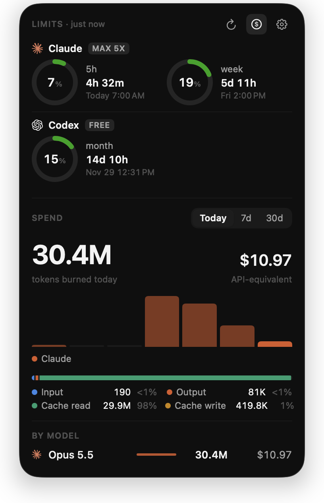

# GlassUsage

Your Claude and Codex plan limits, plus the tokens you burn, in the macOS menu bar.

<p align="center"></p>

A native SwiftUI menu bar app for macOS 26. It uses Liquid Glass and a data-first layout modeled on [TokenHell](https://github.com/ghostpengu/tokenhell). It has no account or server of its own: it reuses the Claude Code and Codex sign-ins already on your Mac.

## Install

1. Download `GlassUsage-<version>.zip` from [Releases](../../releases/latest), unzip it, and move **GlassUsage.app** to Applications.
2. Open it. It shows up in the menu bar, not the Dock. Releases are signed with a Developer ID. If a release isn't notarized yet, macOS blocks the first launch: open **System Settings → Privacy & Security** and click **Open Anyway**, or run `xattr -dr com.apple.quarantine /Applications/GlassUsage.app`.
3. Be signed in to at least one of:
   - **Claude Code** (`claude`), with a Pro, Max, Team or Enterprise plan.
   - **Codex CLI** (`codex`), signed in with ChatGPT.

Requires macOS 26 (Tahoe) or later. Apple silicon and Intel are both supported.

## What it shows

- **Menu bar:** the GlassUsage mark plus the percentage used of whichever limit is closest to running out. The mark dims when the reading is stale. Pick Claude or Codex in Settings. Logo sources are in `docs/logo/`.
- **Limits:** a ring per window (5-hour session, week, or Codex's month), the time left until it resets, and the reset's clock time. Rings are green below 50%, yellow from 50%, orange from 75% and red from 90%.
- **Spend** (toggle with **$**), for Today, 7d or 30d:
  - Tokens burned and the API-equivalent cost.
  - Daily bars stacked by provider.
  - The token mix: input, output, cache read and cache write.
  - The top models.
- **Opening it:** click the menu bar icon, or turn on *Open on hover* to peek. Right-click the icon for Refresh, Settings and Quit.
- **Keys:** ⌘R refreshes, ⌘, opens Settings, ⌘Q quits and Esc closes.

## How it gets the data

| Provider | Limits | Credentials |
|---|---|---|
| Claude | `GET api.anthropic.com/api/oauth/usage` | Claude Code's Keychain item `Claude Code-credentials` (read through `/usr/bin/security`), falling back to `~/.claude/.credentials.json` |
| Codex | `GET chatgpt.com/backend-api/wham/usage` | `~/.codex/auth.json` (`$CODEX_HOME` and `chatgpt_base_url` are honored) |

GlassUsage only reads these credentials; it never stores, refreshes or rewrites them. When the Claude access token has expired, it runs `claude -p /usage` (at most once every 5 minutes) so that Claude Code renews its own token. That is a local command and makes no model request. Both usage endpoints are undocumented and may change.

Token spend is read from local session logs, the same way [ccusage](https://github.com/ryoppippi/ccusage) does it:

| Tool | Logs | Notes |
|---|---|---|
| Claude Code | `~/.claude/projects/**/*.jsonl`, `~/.config/claude/projects` (or `$CLAUDE_CONFIG_DIR`) | Deduplicated by message id + request id |
| Codex CLI | `$CODEX_HOME/sessions/**/rollout-*.jsonl`, `archived_sessions` | Cumulative `token_count` deltas; replayed history in forked sessions is skipped |
| omp | `~/.omp/agent/sessions/**/*.jsonl` | Uses the cost omp recorded; `anthropic` counts toward Claude, `openai`/`openai-codex` toward Codex |

Costs are API-equivalent list prices from [LiteLLM's catalog](https://github.com/BerriAI/litellm/blob/main/model_prices_and_context_window.json), not what a subscription bills you. The catalog is refreshed daily, and a built-in table covers offline use. Only logs changed in the last 30 days are read, and each one is parsed incrementally from where the previous scan stopped.

### Privacy

The app connects to three places:
- `api.anthropic.com`, for Claude limits.
- `chatgpt.com`, for Codex limits.
- `raw.githubusercontent.com`, for the price list.

Logs, parsed totals and settings stay in `~/Library/Application Support/GlassUsage` and the app's preferences. There is no analytics or telemetry.

## Build from source

Requires macOS 26 and Xcode 26 (Swift 6.2).

```sh
git clone https://github.com/bubb4rd/GlassUsage.git && cd GlassUsage
Scripts/build-app.sh --open   # universal build/GlassUsage.app, ad-hoc signed, then launches it
swift run                     # or run unbundled while developing
```

*Launch at login* only works from the `.app` bundle.

### Releasing

`Scripts/release.sh` takes the version from `Support/Info.plist`. It builds a universal app, signs it with your *Developer ID Application* certificate (hardened runtime), notarizes and staples it, and publishes `GlassUsage-<version>.zip` plus its SHA-256 as a GitHub release. Running it again for an existing version replaces the assets. `--no-notarize` skips notarization. Notarizing needs a notarytool keychain profile named `notary` (override with `NOTARY_PROFILE`):

```sh
xcrun notarytool store-credentials notary --apple-id <you@example.com> --team-id <TEAMID>
```

The app icon is generated by `swift Scripts/make-icon.swift`.

## Credits

- Layout and visual language: [TokenHell](https://github.com/ghostpengu/tokenhell) by ghostpengu.
- Log parsing approach: [ccusage](https://github.com/ryoppippi/ccusage). Prices: [LiteLLM](https://github.com/BerriAI/litellm).
- Provider marks: [Simple Icons](https://simpleicons.org) (CC0). Claude is a trademark of Anthropic, and Codex and the OpenAI logo are trademarks of OpenAI.

GlassUsage is an unofficial project and is not affiliated with or endorsed by Anthropic or OpenAI.

## License

[MIT](LICENSE)
