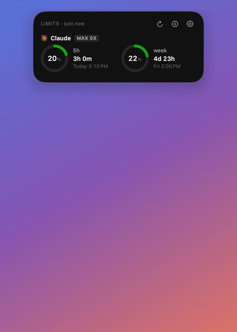

<p align="center">
  <a href="https://github.com/bubb4rd/GlassUsage"></a>
</p>

<h1 align="center">GlassUsage</h1>

<p align="center">
  <a href="https://github.com/bubb4rd/GlassUsage/releases/latest"></a>
  <a href="https://github.com/bubb4rd/GlassUsage/releases"></a>
  
  <a href="LICENSE"></a>
</p>

<p align="center">Your Claude and Codex plan limits, plus the tokens you burn, one click away in the menu bar.</p>

<p align="center"></p>

GlassUsage is a native Liquid Glass menu bar app for macOS. It shows how much of your session and weekly limits you've used and when each one resets, so you're never surprised mid-task. Optionally, it also shows how many tokens you've burned and what they would cost at API prices.

It has no account or server of its own: it reuses the Claude Code and Codex sign-ins already on your Mac, and it never stores your credentials.

## Install

GlassUsage runs on macOS 26 (Tahoe) or later, on Apple silicon and Intel.

**Homebrew**

```sh
brew install --cask bubb4rd/tap/glassusage
```

**Manual download**

1. Download `GlassUsage-<version>.zip` from the [latest release](https://github.com/bubb4rd/GlassUsage/releases/latest) and unzip it.
2. Move **GlassUsage.app** to Applications and open it. It's signed and notarized by Apple, so it opens without a warning.
3. Look for a small ring and a percentage in the menu bar. There's no Dock icon.

To check a download, compare its SHA-256 with the `.sha256` file published next to it:

```sh
shasum -a 256 GlassUsage-1.0.1.zip
```

### Before you start

GlassUsage reads limits from the tools you already use. Sign in to at least one:

- **Claude Code:** run `claude` and sign in with a Pro, Max, Team or Enterprise plan.
- **Codex CLI:** run `codex` and sign in with ChatGPT.

### Updating

GlassUsage updates itself. It checks GitHub for new releases and asks before installing. To check now, open Settings and click **Check for Updates**, or right-click the menu bar icon. Homebrew installs update the same way.

### Uninstalling

Quit GlassUsage (right-click the icon → Quit) and delete it from Applications, or run `brew uninstall --cask glassusage`. To also remove its settings and cache, run `brew uninstall --zap --cask glassusage`, or delete the files listed under [Files on disk](docs/how-it-works.md#files-on-disk).

## Features

- **Session and weekly limits:** a ring per window, with the time until it resets and the exact reset time. Codex plans with a monthly window show that instead. Rings turn yellow at 50%, orange at 75% and red at 90%.
- **Menu bar at a glance:** a ring filled to whichever limit is closest to running out, with its percentage next to it. It dims when the reading is stale.
- **Token spend** (toggle with **$**): tokens burned today, over 7 days and over 30 days, with what they would cost at API prices, daily bars, the token mix (input, output, cache), and your top models.
- **Reads local logs:** spend comes from Claude Code, Codex CLI and omp session logs, parsed incrementally like [ccusage](https://github.com/ryoppippi/ccusage).
- **Out of your way:** click to open, or turn on *Open on hover* to peek. ⌘R refreshes, ⌘, opens Settings, Esc closes.
- **Launch at login**, a selectable refresh interval, and automatic updates.

## Privacy

- **Credentials:** read from Claude Code's Keychain item and Codex's `auth.json`. GlassUsage never stores, refreshes or rewrites them.
- **Logs:** your session logs are read on your Mac and never uploaded.
- **Network:** only Anthropic and OpenAI (for your limits) and GitHub (for prices and updates). No analytics or telemetry.

See [How it works](docs/how-it-works.md) for the exact endpoints, files and formulas.

## FAQ

**Why are the costs so high on a subscription?**
Spend shows what the same tokens would cost on the pay-per-token API. Your plan doesn't bill per token. Treat it as a way to compare days and models, not as a bill.

**A provider shows "Sign in with Claude Code…" instead of rings.**
Sign in with `claude` or `codex` in Terminal, then click refresh (⌘R).

**Is this official?**
No. GlassUsage is an independent project and is not affiliated with Anthropic or OpenAI. It uses the same undocumented usage endpoints as Claude Code and Codex, and those can change. Updates will follow when they do.

## Build from source

Requires macOS 26 and Xcode 26 (Swift 6.2).

```sh
git clone https://github.com/bubb4rd/GlassUsage.git
cd GlassUsage
Scripts/build-app.sh --open    # universal build/GlassUsage.app, ad-hoc signed, then launches it
```

`swift run` also works while developing, but *Launch at login* and updates only work from the `.app` bundle.

Maintainers: see [Releasing](docs/releasing.md).

## Contributing

Bug reports and pull requests are welcome. Please include your macOS version and which provider (Claude or Codex) is involved. To report a security issue, see [SECURITY.md](SECURITY.md).

## Credits

- Visual language: [TokenHell](https://github.com/ghostpengu/tokenhell) by ghostpengu
- Log parsing approach: [ccusage](https://github.com/ryoppippi/ccusage); prices: [LiteLLM](https://github.com/BerriAI/litellm)
- Updates: [Sparkle](https://sparkle-project.org)
- Provider marks: [Simple Icons](https://simpleicons.org) (CC0). Claude is a trademark of Anthropic, and Codex and the OpenAI logo are trademarks of OpenAI.

## License

[MIT](LICENSE)
