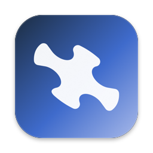
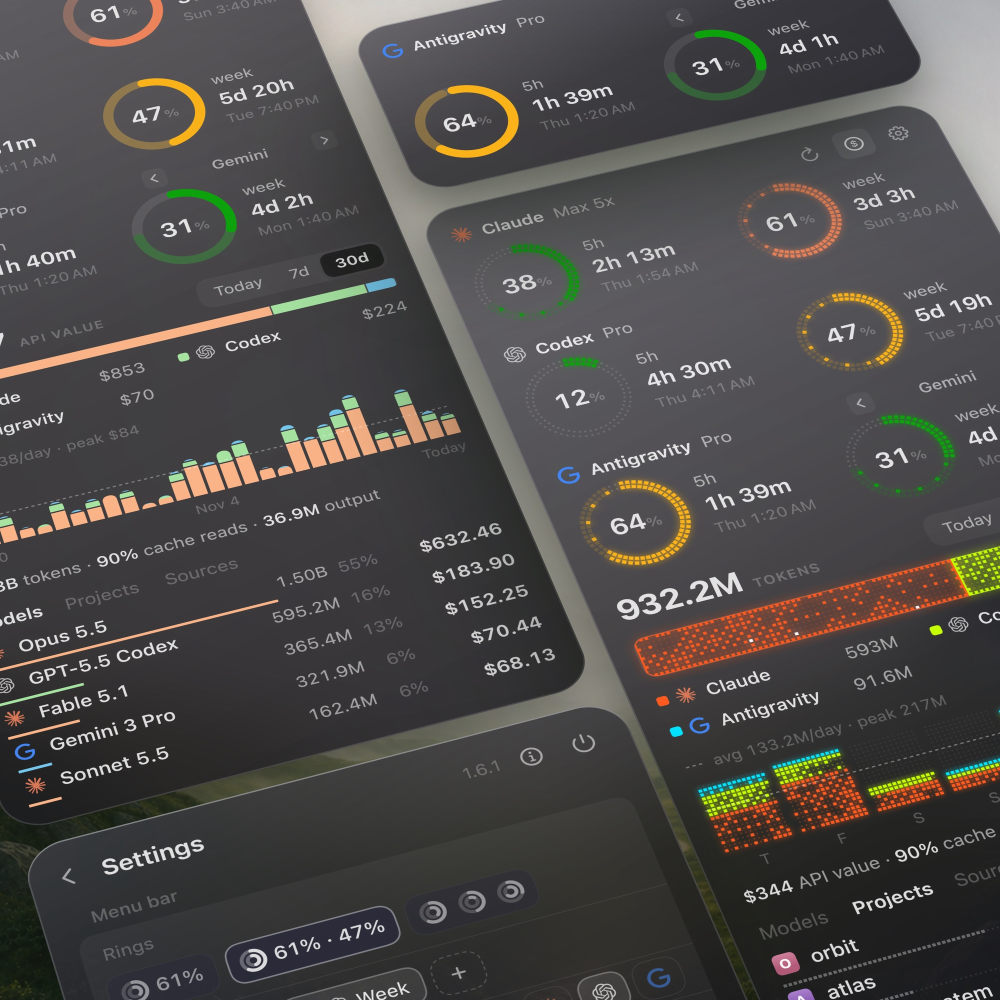
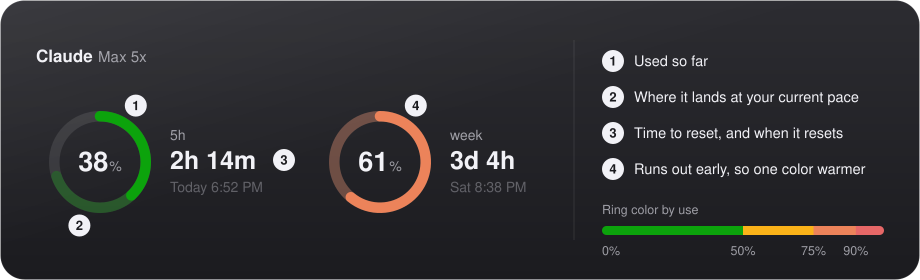
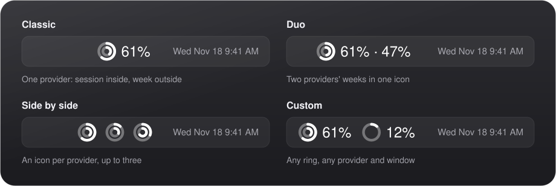
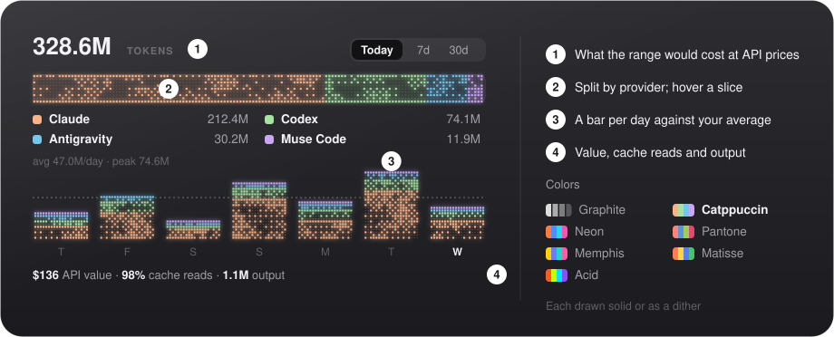
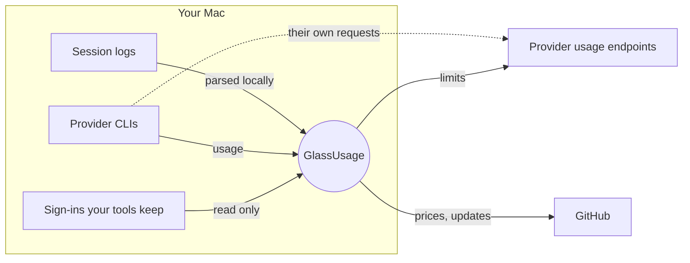

<p align="center">
  <a href="https://github.com/bubb4rd/GlassUsage"></a>
</p>

<h1 align="center">GlassUsage</h1>

<p align="center">
  <a href="https://github.com/bubb4rd/GlassUsage/releases/latest"></a>
  
  <a href="LICENSE"></a>
</p>

<p align="center">Your AI coding plan limits, plus the tokens you burn, one click away in the menu bar.</p>

<p align="center">
  <a href="#install">Install</a> ·
  <a href="#features">Features</a> ·
  <a href="#supported-providers">Providers</a> ·
  <a href="#privacy">Privacy</a> ·
  <a href="#faq">FAQ</a>
</p>

<p align="center"></p>

GlassUsage is a native Liquid Glass menu bar app for macOS. It shows how much of each AI plan's session and weekly limits you've used and when each resets, across every provider you sign in to, so you're never surprised mid-task. Optionally, it shows the tokens you've burned and what they would cost at API prices.

No account, no server: it reuses the sign-ins your coding tools already keep on your Mac and never stores your credentials.

## Install

```sh
brew install --cask bubb4rd/tap/glassusage
```

Or download `GlassUsage-<version>.zip` from the [latest release](https://github.com/bubb4rd/GlassUsage/releases/latest), unzip it, and move **GlassUsage.app** to Applications. It's signed and notarized, so it opens without a warning.

Look for a small double ring and a percentage in the menu bar; there's no Dock icon. Sign in to at least one [supported provider](#supported-providers) with its own CLI and GlassUsage picks it up on launch. Needs macOS 26 (Tahoe) or later, on Apple silicon or Intel.

<details>
<summary><b>Verify the download</b></summary>

Keep the zip and the `.sha256` file published next to it in the same folder, then run:

```sh
shasum -a 256 -c GlassUsage-*.zip.sha256    # prints "GlassUsage-<version>.zip: OK"
```

</details>

<details>
<summary><b>Updating</b></summary>

GlassUsage updates itself, Homebrew installs included. It checks GitHub for new releases and asks before installing. When a new version is out, a dot appears on the gear and Settings shows a green **Update** button. To check by hand, click the download arrow in Settings or right-click the menu bar icon → **Check for Updates…**. Changes are listed on the [Releases](https://github.com/bubb4rd/GlassUsage/releases) page.

</details>

<details>
<summary><b>Uninstalling</b></summary>

Quit GlassUsage (right-click the icon → Quit) and delete it from Applications, or run `brew uninstall --cask glassusage`. To also remove its settings and cache, run `brew uninstall --zap --cask glassusage`, or delete the files listed under [Files on disk](docs/how-it-works.md#files-on-disk).

</details>

## Features

### Limits at a glance



- **A ring per window:** session, weekly, or monthly where the plan has one, with the time left and the exact reset.
- **Pace:** the faint arc shows where the window lands at your current pace. Running out before the reset warms the ring one step past its usage, so a ring at 36% turns yellow, not red. Hover a ring to see when it hits 100%.
- **Model groups:** providers that meter groups separately get arrows to step between them, starting on the one closest to its limit or the one picked in Settings.
- **Alerts:** a notification when any limit reaches 50%, 75% or 90%, and another when it resets. Off by default.

### Your menu bar, your rings



Pick a layout under *Rings* in Settings, then click any ring to point it at a provider's session, week, or whichever window is closer to its limit. **+** adds a ring or an icon; hover one for **×** to remove it. Edits are kept as **Custom**, so trying a preset never loses them. A ring dims when its reading is stale or failed, and hovering the menu bar item names every ring.

### Token spend

Toggle with **$**. See what today, the last 7 days or the last 30 days would cost at API prices: a bar per day against your daily average, the tokens, cache reads and output behind it, and your top models, projects or sources, each with its share. With more than one provider, a bar splits the spend between them; hover a slice or a name to pick it out.



Projects are the git repository each session ran in, so subfolders, worktrees and submodules count toward their repository, shown with the project's own app icon, logo or favicon.

<details>
<summary><b>Projects in Documents, Desktop and other protected folders</b></summary>

macOS asks before an app reads Documents, Desktop, Downloads, cloud storage or external drives. For projects there, logos and repository lookup need *Projects in Documents & Desktop* in Settings, or *Read projects in Documents & Desktop* under the Projects list.

</details>

### Make it yours

| Setting | Options |
|---|---|
| **Show** | *Value*: dollars lead · *Tokens*: token counts lead and lists rank by them |
| **Chart** | *Ledger*: a bar per day · *Calendar*: weeks by weekday, with weekly totals |
| **Colors** | *Graphite*: gray steps, the default · a color per provider in *Catppuccin*, *Neon*, *Pantone*, *Memphis*, *Matisse* or *Acid*, each shown with its swatch in the menu |
| **Fill** | *Solid* · *Dither*: a dot matrix on rings and charts that glows in dark mode |
| **Lists** | Any of Models, Projects and Sources, or none |
| **Open on hover** | Peek without clicking; moving away closes it |
| **General** | Refresh every 2 to 30 min · Launch at login · Update automatically |

<kbd>⌘</kbd><kbd>R</kbd> refreshes, <kbd>⌘</kbd><kbd>,</kbd> opens Settings, <kbd>Esc</kbd> closes.

## Supported providers

| Provider | Plan limits | Read via | Token spend from | Sign in with |
|---|---|---|---|---|
| Claude | Session · Weekly | API | Claude Code | `claude` |
| Codex | Session · Weekly · Monthly | API | Codex CLI | `codex` |
| Antigravity | Session · Weekly · Model groups | CLI | Antigravity CLI, app, IDE, T3 Code | `agy` |
| Muse Code | Session · Weekly | CLI | Muse Code | `muse login` |

**API:** GlassUsage asks the provider's usage service with the login its tool already keeps. **CLI:** it asks the provider's own command-line tool, so it never sees the login. Plan limits need a subscription sign-in; API-key logins have no limits to show. Sessions run through omp count toward the provider they used.

Want another provider? [Open an issue](https://github.com/bubb4rd/GlassUsage/issues) with the tool you use and how it reports usage.

## Privacy



- **Credentials** are never stored, refreshed or rewritten.
- **Logs** are parsed incrementally on your Mac, like [ccusage](https://github.com/ryoppippi/ccusage), and never uploaded.
- **No analytics or telemetry.** Nothing else leaves your Mac.

[How it works](docs/how-it-works.md) lists the exact endpoints, files and formulas.

## FAQ

<details>
<summary><b>Why are the costs so high on a subscription?</b></summary>

Spend shows what the same tokens would cost on the pay-per-token API. Your plan doesn't bill per token. Treat it as a way to compare days and models, not as a bill.

</details>

<details>
<summary><b>A provider shows "Sign in with…" instead of rings.</b></summary>

Sign in with that provider's CLI in Terminal (the command is under [Supported providers](#supported-providers)), then refresh with <kbd>⌘</kbd><kbd>R</kbd>.

</details>

<details>
<summary><b>Is this official?</b></summary>

No. GlassUsage is an independent project and is not affiliated with any of the providers it supports. It uses the same undocumented usage endpoints and commands as their official tools, and those can change. Updates will follow when they do.

</details>

## Build from source

Requires macOS 26 and Xcode 26 (Swift 6.2).

```sh
git clone https://github.com/bubb4rd/GlassUsage.git
cd GlassUsage
Scripts/build-app.sh --open    # universal build/GlassUsage.app, ad-hoc signed, then launches it
```

`swift run` also works while developing, but *Launch at login* and updates only work from the `.app` bundle. `swift test` runs the provider parsing tests. Maintainers: see [Releasing](docs/releasing.md).

## Contributing

Bug reports and pull requests are welcome. Please include your macOS version and which provider is involved. To report a security issue, see [SECURITY.md](SECURITY.md).

## Credits

- Visual language: [TokenHell](https://github.com/ghostpengu/tokenhell) by ghostpengu
- Log parsing approach: [ccusage](https://github.com/ryoppippi/ccusage); prices: [LiteLLM](https://github.com/BerriAI/litellm)
- Updates: [Sparkle](https://sparkle-project.org)
- Provider marks: [Simple Icons](https://simpleicons.org) (CC0). Claude is a trademark of Anthropic; Codex and the OpenAI logo are trademarks of OpenAI; Google and Antigravity are trademarks of Google; Meta and Muse are trademarks of Meta.

## License

[MIT](LICENSE)
